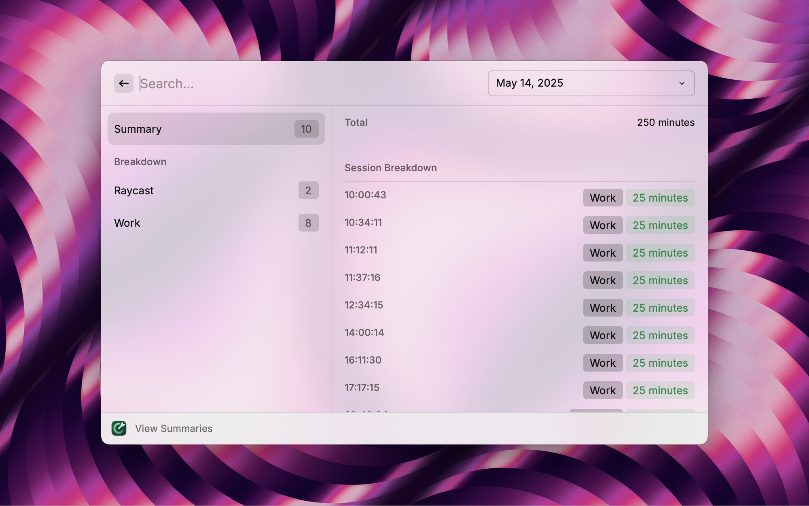

# Raycast Focus Stats (fork)

A Raycast extension that shows your [Raycast Focus](https://manual.raycast.com/focus) history: daily totals, a breakdown
by goal, and every individual session.

This is a personal fork of [Raycast Focus Stats](https://www.raycast.com/dinocosta/raycast-focus-stats) by
[Dino Costa](https://github.com/dinocosta). It is not affiliated with or endorsed by Raycast.



<sub>Screenshot from the original extension. In this fork the command is called View Focus Stats.</sub>

## Why this fork exists

On current versions of Raycast, the original extension stopped picking up completed Focus sessions, even after running
its Sync Sessions command. Raycast still records each session in its app logs. This fork reads those logs instead.

It also changes the three original commands:

| Original                                        | This fork                                                        |
| ----------------------------------------------- | ---------------------------------------------------------------- |
| Sync Sessions, View Sessions, View Summaries    | View Focus Stats, plus Sync Focus Sessions for the background    |
| Sync runs as a separate command                 | Syncs when you open View Focus Stats, and in the background      |
| Reads macOS system logs                         | Reads Raycast's app logs, and falls back to system logs if needed |

## Install

The fork isn't in the Raycast Store, so you install it from source. You need:

- macOS with [Raycast](https://www.raycast.com) installed
- [Node.js](https://nodejs.org) 22.14 or later, and Git

Then run:

```sh
git clone https://github.com/sebtsang/raycast-focus-stats.git
cd raycast-focus-stats
npm install
npm run dev
```

`npm run dev` builds the extension and adds it to Raycast. Once it prints `built extension successfully`, press
`Ctrl+C`. The extension stays installed.

Don't install it next to the Store version of Raycast Focus Stats. Both use the same extension name.

To update, pull the latest changes and run `npm install` and `npm run dev` again.

To uninstall, search for View Focus Stats in Raycast, open the action panel with `⌘K`, and remove the extension.

## Use

1. Run a Focus session in Raycast and complete it.
2. Open **View Focus Stats**. It syncs new sessions, then lists every session under its date.
3. Use the date dropdown to see one day's total and goals. Use **Refresh** in the action panel to sync again while the view is open.

To save sessions without opening View Focus Stats, open it once, then turn on **Background Refresh** for **Sync Focus
Sessions** in Raycast's extension settings. It syncs every 10 minutes while Raycast is running.

## How it works

Raycast doesn't give extensions access to Focus history. This extension reads the Focus start and completion events
from Raycast's app logs in `~/Library/Logs/com.raycast.macos`, pairs them into sessions, and saves them in a SQLite
database in the extension's own support folder.

The log lines have a time but no date, and Raycast trims old lines from a log that stays open for days. The extension
counts midnights back from when the log was last modified, as Raycast's own log collector does. It also saves Raycast's
ID for each session, so syncing again can't add a session twice or change its date.

Everything stays on your Mac. The extension makes no network requests.

Raycast doesn't document these logs, so a Raycast update could change their format and break syncing. Raycast also
deletes old log files. Without background sync, the extension can miss sessions whose log lines are already gone. A date
can be wrong if Raycast logs nothing for about a day between a session and its first sync. Sessions already in the database stay there.

## Development

```sh
npm test       # log parsing and database migration tests
npm run lint   # Raycast's linter
npm run dev    # rebuild and reload in Raycast while you edit
```

## Credits

- [Dino Costa](https://github.com/dinocosta) wrote the original
  [Raycast Focus Stats](https://github.com/raycast/extensions/tree/main/extensions/raycast-focus-stats) extension in the
  [raycast/extensions](https://github.com/raycast/extensions) repository.
- [Per Nielsen Tikær](https://github.com/pernielsentikaer) is listed as a contributor to the original.
- `package.json` keeps Dino Costa as the extension's author.

## License

[MIT](./LICENSE), the same license as the original. The license file keeps the original copyright notice.
